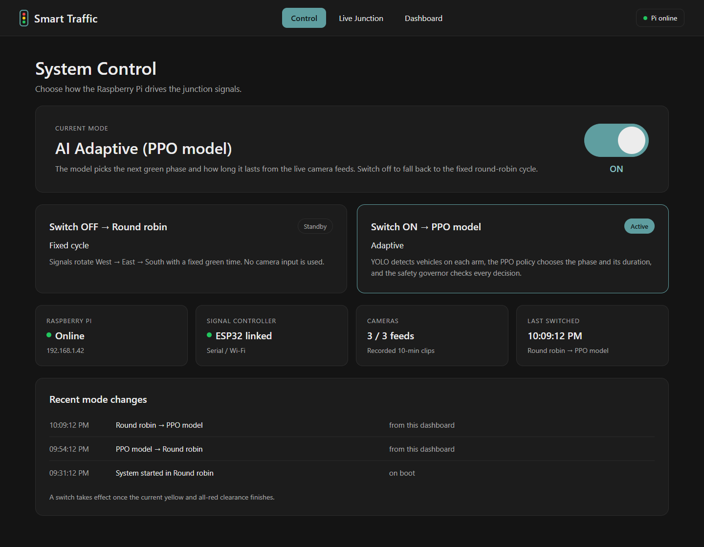
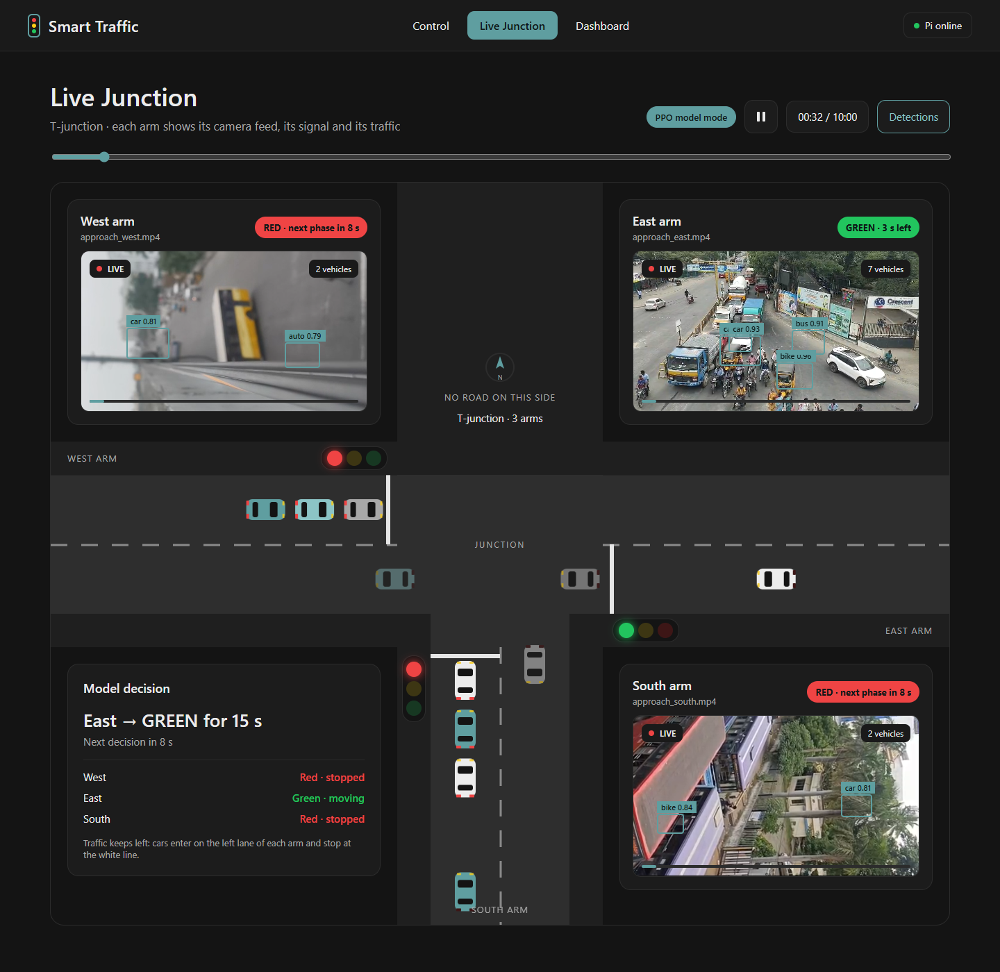
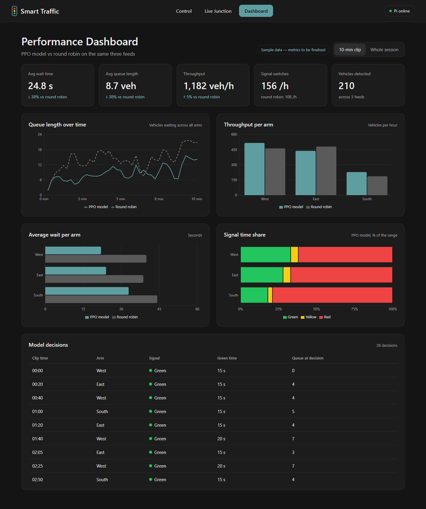

# Smart Traffic UI

Frontend for the Smart Traffic patent demo: a T-junction (West, East, South arms) whose signals are driven either by a fixed round-robin cycle or by a PPO model fed by YOLO detections from three cameras.

Stack: React 19 · Vite 6 · TypeScript · React Router · Recharts.

| Route        | Page          | What it shows                                                                          |
| ------------ | ------------- | -------------------------------------------------------------------------------------- |
| `/`          | Control       | PPO / round-robin mode switch, device status, recent mode changes                       |
| `/junction`  | Live Junction | Animated top-down T-junction, three synced camera feeds, current decision, scrub bar    |
| `/dashboard` | Dashboard     | KPI tiles, queue / throughput / wait / signal-share charts, model decision log          |





## Run it

```bash
npm install
npm run dev        # http://localhost:5173/Smart-Traffic-UI/
npm run build      # type-check + production build into dist/
npm run lint
npm run preview    # serve dist/ (videos are served here too)
```

Node 20+ is required (Node 23.6+ if you want to run the timeline generator script directly).

## Camera videos

Drop the three 10-minute clips into the `videos/` folder at the repo root with exactly these names:

```
videos/approach_west.mp4
videos/approach_east.mp4
videos/approach_south.mp4
```

- The dev and preview servers serve that folder at `/Smart-Traffic-UI/videos/` (with range requests, so seeking works).
- The clips are ~125 MB each, over GitHub's 100 MB file limit, so `videos/` is **git-ignored** and the files are never copied into `dist/`.
- A missing file shows a dark "Video feed" placeholder instead of the video.
- To host the clips elsewhere (CDN, the Pi, …) set `VITE_VIDEO_BASE_URL`, e.g. `VITE_VIDEO_BASE_URL=https://example.com/clips/`.

All three videos, the decision timeline and the car animation follow one shared clip clock (`src/data/clock.ts`); play/pause and the scrub bar on the Live Junction page drive all of them together.

## Data layer

Components never fetch data themselves; everything goes through the `DataSource` interface in `src/data/types.ts`:

```ts
interface DataSource {
  getMode(): Promise<Mode>
  setMode(m: Mode): Promise<Mode>          // resolves once the controller confirms
  getStatus(): Promise<DeviceStatus>
  getModeHistory(): Promise<ModeChange[]>
  subscribeDecisions(cb: (d: Decision) => void): () => void
  getMetrics(range: 'clip' | 'session'): Promise<Metrics>
}
```

```
src/data/
  types.ts              Mode, Arm, Signal, Decision, DeviceStatus, Metrics, DataSource
  index.ts              picks the source from VITE_DATA_SOURCE, owns the shared clock
  signals.ts            signal rules: green → 3 s yellow → 2 s all-red, one green at a time
  clock.ts              shared 10-minute clip clock
  hooks.ts              React hooks (useMode, useStatus, useDecision, useMetrics, useClock)
  mock/
    MockDataSource.ts   the default source
    ppo_timeline.json   ~10-min PPO decision timeline (generated)
    sim.ts              deterministic queue simulator behind all mock numbers
  api/
    ApiDataSource.ts    stub for the real Pi backend (TODOs)
```

The KPI tiles on the dashboard come from one config array, `src/config/metrics.ts`. Add, remove or reorder entries there.

To regenerate the PPO timeline after changing the simulator: `node scripts/gen-ppo-timeline.ts`.

## Switching to the real API

1. Create `.env.local`:
   ```
   VITE_DATA_SOURCE=api
   VITE_API_BASE_URL=http://<pi-ip>:<port>
   ```
2. Implement or confirm the endpoints in `src/data/api/ApiDataSource.ts`:
   - `GET /api/mode` → `{ mode }`
   - `POST /api/mode` `{ mode }` → `{ mode }` (respond after the yellow + all-red clearance)
   - `GET /api/status` → `DeviceStatus`
   - `GET /api/mode/history` → `ModeChange[]` *(proposed)*
   - `GET /api/metrics?range=clip|session` → `Metrics` *(proposed)*
   - WebSocket `/ws/decisions`: one `Decision` JSON per message
3. No component changes are needed; they only see the `DataSource` interface.

## Deploying to GitHub Pages

`npm run deploy` builds and publishes `dist/` to the `gh-pages` branch. The build copies `index.html` to `404.html` so deep links like `/junction` work. The videos are not deployed (see above), so feeds show the placeholder unless `VITE_VIDEO_BASE_URL` points somewhere public.

## Other docs

- [SYSTEM_ANALYSIS.md](SYSTEM_ANALYSIS.md): analysis of the Smart-Traffic-PPO system
- [INTEGRATION_GUIDE.md](INTEGRATION_GUIDE.md): hardware/gateway notes (written for the previous UI)
